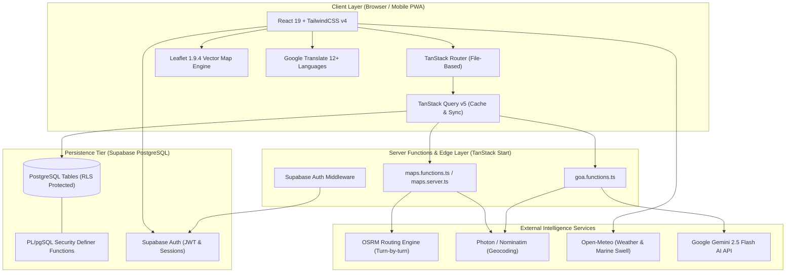
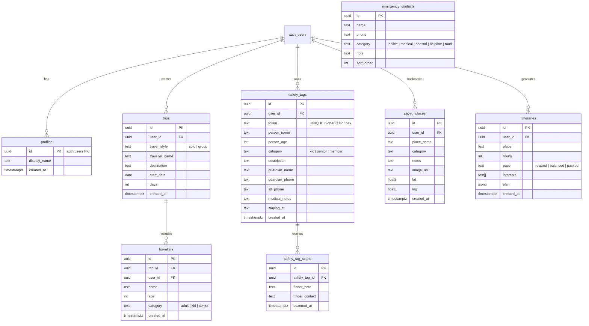
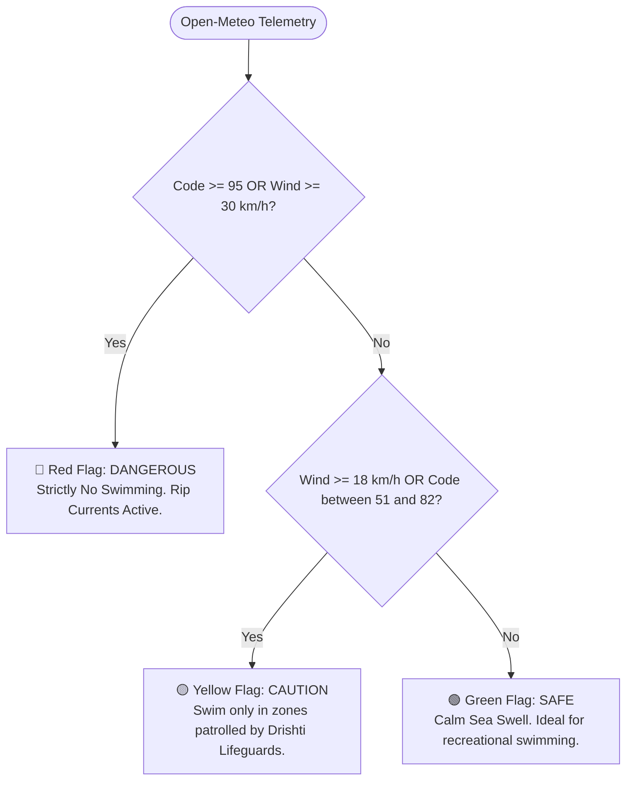
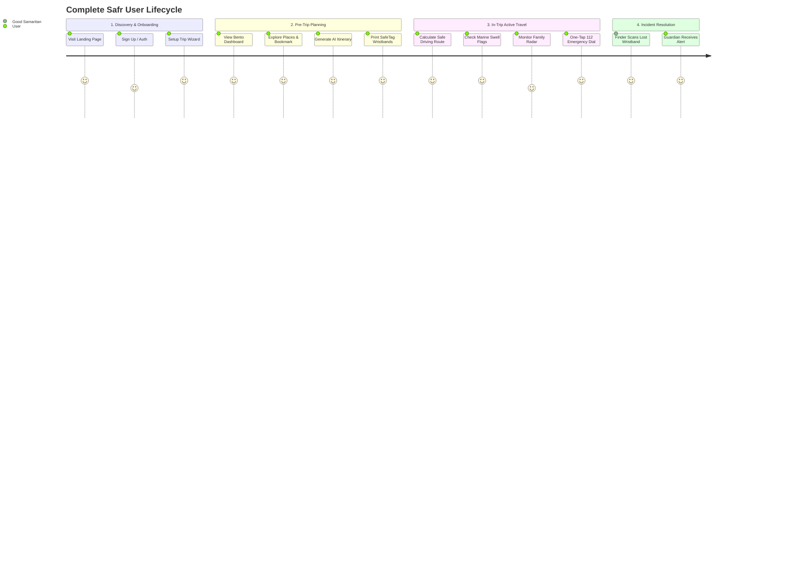

# 🌴 Safr (Goa Guide Buddy) — Complete End-to-End Project Documentation & Technical Blueprint

> **Piloted in Goa · Engineered for India**  
> **Core Tagline:** *"Travel safer. Skip the trouble."*  
> **Development Team:** Team KoS  
> **Lead Architect / Engineer:** Prajwal ([@Prajj11](https://github.com/Prajj11))  
> **Document Version:** 2.0 (Exhaustive Master Edition)  
> **Reference Document:** [`information.md`](file:///c:/Users/prajw/OneDrive/Documents/PCCE%20stuff/Ideas/Tourism%20Guide/information.md)

---

## 📌 Table of Contents
1. [Executive Summary & Problem Statement](#1-executive-summary--problem-statement)
2. [End-to-End System Architecture & Data Flow](#2-end-to-end-system-architecture--data-flow)
3. [Exhaustive Technology Stack & Dependency Audit](#3-exhaustive-technology-stack--dependency-audit)
4. [Database Architecture, Schema & Zero-Knowledge Security](#4-database-architecture-schema--zero-knowledge-security)
5. [Algorithms, Mathematical Formulations & Heuristics](#5-algorithms-mathematical-formulations--heuristics)
6. [Complete Application Modules & User Journey Breakdown](#6-complete-application-modules--user-journey-breakdown)
7. [Comprehensive Codebase Directory & File-by-File Breakdown](#7-comprehensive-codebase-directory--file-by-file-breakdown)
8. [UI/UX Design System: "Coastal Cyber-Luxury"](#8-uiux-design-system-coastal-cyber-luxury)
9. [Curated Local Geographic & Safety Knowledge Base](#9-curated-local-geographic--safety-knowledge-base)
10. [Local Development, Setup, Environment & Deployment Manual](#10-local-development-setup-environment--deployment-manual)

---

## 1. Executive Summary & Problem Statement

### 1.1 Project Genesis & Mission
Tourism in India is vibrant, culturally rich, and economically vital. However, domestic and international travelers regularly face critical safety, navigation, and coordination challenges. In destinations like Goa, tourists encounter:
- **Hazardous Night-Time Driving:** Winding, unlit Western Ghat hairpin roads, narrow rural lanes, and high accident rates on sections of NH66.
- **Ocean & Beach Hazards:** Unpredictable seasonal sea swells, sudden rip currents, and lack of immediate flag awareness leading to preventable drownings.
- **Lost Family Members in Massive Crowds:** Crowded flea markets (Anjuna), popular beaches (Baga, Calangute), and music festivals where young children or elderly grandparents get separated with no cell signal or language barrier.
- **Aggressive Transport Pricing & Scams:** Unregulated private taxi cartels, lack of transparent transport advice (e.g., when a scooter is needed vs. when a 4x4 jeep safari is legally required for Dudhsagar).
- **Language Barriers During Emergencies:** Tourists from non-Hindi or non-Konkani speaking states struggling to communicate urgent needs to local responders.

**Safr** was engineered from the ground up to solve these problems. It is not just another travel recommendation directory; it is a **full-stack AI safety companion** that marries real-time geospatial intelligence, crowd analytics, marine lifeguarding safety flags, Zero-Knowledge family wristbands, and generative AI planning into one cohesive, luxury-grade web application.

### 1.2 Core Target Personas
1. **The Solo Voyager:** Seeking verified, safe night routes, well-lit populated corridors, and instant emergency 112 connectivity.
2. **The Family with Children & Seniors:** Requiring waterproof printable QR safety wristbands with zero personal info leaks, relaxed-pace itineraries, and direct hospital/lifeguard hotlines.
3. **The Backpacking Explorer:** Looking for real-time crowd gauges to skip tourist traps, rental scooter navigation through narrow coastal alleys, and budget-friendly Kadamba bus/ferry routes.
4. **The Good Samaritan / Beach Finder:** A bystander who finds a lost child on a beach and needs a frictionless, privacy-preserving way to alert the parents immediately via OTP.

---

## 2. End-to-End System Architecture & Data Flow

Safr employs a modern full-stack server-function architecture leveraging **TanStack Start**, **React 19**, **Supabase PostgreSQL**, and edge server functions.



### 2.1 Request & Data Flow Walkthrough
1. **Client Interaction:** When a user searches for a route from Panjim to Baga Beach, `map.tsx` calls the server function `getRoutes` via TanStack Start.
2. **Geospatial Processing:** `maps.server.ts` queries the Open Source Routing Machine (OSRM) API for multiple alternative paths, distance matrices, and maneuver step lists.
3. **Safety Scoring Engine:** The server evaluates road categories (checking for highway vs. village roads via regex), time of day (checking if night travel penalty applies between 19:00 and 06:00), detour ratios, and hairpin turns to assign a safety rating (30–98) to each route.
4. **Fallback Synthesis:** If fewer than 3 distinct paths exist, the server dynamically calculates intermediate waypoint offsets ($\pm 0.018^\circ$ lat/lng) to synthesize a third scenic alternative.
5. **Client Presentation:** The client receives typed `ScoredRoute` objects, draws interactive polylines on Leaflet, populates the step-by-step turn drawer, and provides a 1-tap Google Maps navigation link.
6. **Data Persistence:** User preferences, trips, party members, saved bucket list places, and SafeTag records are committed to Supabase PostgreSQL, strictly secured by Row Level Security (RLS) policies.

---

## 3. Exhaustive Technology Stack & Dependency Audit

Every package in Safr was intentionally selected to balance runtime performance, type safety, visual elegance, and low network overhead.

### 3.1 Core Frameworks & Build Tooling
| Package | Version | Purpose in Safr |
|---|---|---|
| `react` | `^19.2.0` | Next-generation React core supporting Server Actions, Actions hooks, and concurrent rendering. |
| `react-dom` | `^19.2.0` | DOM renderer for React 19. |
| `typescript` | `^5.8.3` | Strict static typing across schemas, server functions, database models, and UI components. |
| `vite` | `^8.2.0` | Ultra-fast build tool, local dev server with Hot Module Replacement (HMR). |
| `@tanstack/react-start` | `1.168.32` | Full-stack SSR framework providing type-safe server functions (`createServerFn`) and streaming SSR. |
| `@tanstack/react-router` | `1.170.18` | Type-safe, file-based routing system with search parameter validation (`validateSearch`). |
| `@tanstack/router-plugin` | `1.168.23` | Vite plugin automatically compiling file-based route trees into `routeTree.gen.ts`. |
| `@tanstack/react-query` | `^5.101.1` | Server-state management, asynchronous query caching, background polling, and optimistic UI mutations. |

### 3.2 Styling, Typography & Design Tokens
| Package | Version | Purpose in Safr |
|---|---|---|
| `tailwindcss` | `^4.2.1` | Next-generation utility CSS engine operating directly on OKLCH color spaces and CSS variables. |
| `@tailwindcss/vite` | `^4.2.1` | Native Vite integration for Tailwind v4 compiler. |
| `tw-animate-css` | `^1.3.4` | Modern CSS animation utilities for smooth entrances, pulse states, and exits. |
| `clsx` | `^2.1.1` | Utility for conditionally constructing `className` strings. |
| `tailwind-merge` | `^3.5.0` | Merges conflicting Tailwind CSS classes efficiently without style collisions. |
| `class-variance-authority` | `^0.7.1` | Component variant abstraction for design system buttons, badges, and cards. |

### 3.3 UI Components & Accessible Primitives (Radix UI)
| Package | Version | Purpose in Safr |
|---|---|---|
| `@radix-ui/react-dialog` | `^1.1.15` | Accessible modal dialogs for the 7-day marine forecast, trip editor, and family member manager. |
| `@radix-ui/react-popover` | `^1.1.15` | Floating popover overlays for filters and contextual info. |
| `@radix-ui/react-accordion` | `^1.2.12` | Collapsible FAQs, rules, and step-by-step turn directions. |
| `@radix-ui/react-tabs` | `^1.1.13` | Tabbed navigation for Saved Places wishlist vs. All Places. |
| `@radix-ui/react-dropdown-menu` | `^2.1.16` | User profile actions, sign-out menu, and export actions. |
| `@radix-ui/react-slider` | `^1.3.6` | Free-hours slider (1–24 hours) on the AI Itinerary page. |
| `@radix-ui/react-select` | `^2.2.6` | Dropdown selectors for Goan destination hubs and travel style. |
| `@radix-ui/react-label` | `^2.1.8` | Accessible form labels for onboarding and safe tags. |
| `@radix-ui/react-separator` | `^1.1.8` | Structural dividers between bento grid sections. |
| `@radix-ui/react-slot` | `^1.2.4` | Polymorphic component primitive (`asChild` pattern). |
| `vaul` | `^1.1.2` | Mobile-first drawer primitive for the turn-by-turn directions drawer. |
| `cmdk` | `^1.1.1` | Fast command palette and place search autocomplete. |
| `sonner` | `^2.0.7` | Rich, non-blocking toast notifications for user actions and emergency dial confirmations. |
| `lucide-react` | `^0.575.0` | Comprehensive icon library for maneuvers, weather, emergency, radar, and navigation. |

### 3.4 Geospatial, AI & Specialized Libraries
| Package | Version | Purpose in Safr |
|---|---|---|
| `leaflet` | `^1.9.4` | Lightweight, mobile-friendly interactive mapping library for vector tiles and markers. |
| `@types/leaflet` | `^1.9.22` | Strict TypeScript definitions for Leaflet maps, polylines, and div icons. |
| `qrcode` | `^1.5.4` | Generates high-contrast QR codes for printable family safety wristbands. |
| `@types/qrcode` | `^1.5.6` | Type definitions for QR code generation options. |
| `@google/genai` / `@ai-sdk/google` | `^4.0.44` | Integration with Google Gemini 2.5 Flash for high-speed dynamic itinerary synthesis. |
| `ai` | `^7.0.58` | Vercel AI SDK core for structured prompt streaming and output handling. |
| `zod` | `^3.24.2` | Runtime schema validation for server functions, place insights, and itinerary payloads. |
| `date-fns` | `^4.1.0` | Date manipulation and formatting for trip dates and timestamps. |
| `react-hook-form` | `^7.71.2` | High-performance form state management with minimal re-renders. |
| `@hookform/resolvers` | `^5.2.2` | Zod validation resolver for React Hook Form. |
| `input-otp` | `^1.4.2` | Accessible 6-character OTP input component for finder code verification. |
| `recharts` | `^2.15.4` | Data visualization charts for crowd analytics and weather curves. |
| `embla-carousel-react` | `^8.6.0` | Smooth touch carousel for featured Goan beach cards. |

---

## 4. Database Architecture, Schema & Zero-Knowledge Security

Safr uses **Supabase PostgreSQL** with Row Level Security (RLS) enabled on all tables, supplemented by custom PL/pgSQL stored procedures.

### 4.1 Database Entity-Relationship Diagram (ERD)



### 4.2 Detailed Table Specifications

#### 1. `profiles`
- **Purpose:** Stores user profile preferences and display names, automatically populated upon Supabase user signup.
- **Columns:**
  - `id` (`uuid`, PK): Foreign key to `auth.users.id` with `ON DELETE CASCADE`.
  - `display_name` (`text`): User's chosen name or the prefix of their email address.
  - `created_at` (`timestamptz`): Record creation timestamp.
- **Trigger:** `on_auth_user_created` automatically runs `public.handle_new_user()` upon user registration.

#### 2. `trips`
- **Purpose:** Represents a planned or active holiday in Goa.
- **Columns:**
  - `id` (`uuid`, PK): Default `gen_random_uuid()`.
  - `user_id` (`uuid`, FK): Points to `auth.users(id)` with `ON DELETE CASCADE`.
  - `travel_style` (`text`): `'solo'` or `'group'`.
  - `traveller_name` (`text`): Full name of the primary user or group leader.
  - `destination` (`text`): Primary base destination (e.g., `"Panjim"`, `"Baga Beach"`).
  - `start_date` (`date`): Trip start date.
  - `days` (`integer`): Number of vacation days planned.
  - `created_at` (`timestamptz`): Default `now()`.

#### 3. `travellers`
- **Purpose:** Tracks every individual accompanying the primary traveler.
- **Columns:**
  - `id` (`uuid`, PK): Default `gen_random_uuid()`.
  - `trip_id` (`uuid`, FK): Cascade deletes with `trips.id`.
  - `user_id` (`uuid`, FK): Owning user ID for RLS checks.
  - `name` (`text`): Companion name.
  - `age` (`integer`, optional): Age in years.
  - `category` (`text`): `'adult'`, `'kid'`, or `'senior'`.
  - `created_at` (`timestamptz`): Default `now()`.

#### 4. `safety_tags`
- **Purpose:** Stores printable safety wristband records for vulnerable travelers (children and senior citizens).
- **Columns:**
  - `id` (`uuid`, PK): Default `gen_random_uuid()`.
  - `user_id` (`uuid`, FK): Guardian's user account.
  - `token` (`text`, UNIQUE): Unique 6-character OTP or 16-byte hex token encoded for QR URLs (`/t/$token`).
  - `person_name` (`text`): Name of the child or senior.
  - `person_age` (`integer`, optional): Age.
  - `category` (`text`): `'kid'`, `'senior'`, or `'member'`.
  - `description` (`text`, optional): Identifying clothing, hair color, or physical traits.
  - `guardian_name` (`text`): Parent or caretaker's name.
  - `guardian_phone` (`text`): Emergency primary phone number.
  - `alt_phone` (`text`, optional): Secondary contact number.
  - `medical_notes` (`text`, optional): Allergies, asthma, diabetes, or medication requirements.
  - `staying_at` (`text`, optional): Resort, hotel, or villa address.
  - `created_at` (`timestamptz`): Default `now()`.

#### 5. `safety_tag_scans`
- **Purpose:** Incident log created whenever a Good Samaritan scans a QR code or submits an alert via `/find`.
- **Columns:**
  - `id` (`uuid`, PK): Default `gen_random_uuid()`.
  - `safety_tag_id` (`uuid`, FK): Cascade deletes with `safety_tags.id`.
  - `finder_note` (`text`): Message from the finder (e.g., "Found near Tito's Lane beach shack, sitting with lifeguard").
  - `finder_contact` (`text`): Good Samaritan's phone number so the guardian can call them back.
  - `scanned_at` (`timestamptz`): Timestamp of the alert.

#### 6. `saved_places`
- **Purpose:** User bucket list and wishlist bookmarks.
- **Columns:**
  - `id` (`uuid`, PK): Default `gen_random_uuid()`.
  - `user_id` (`uuid`, FK): Cascade deletes with `auth.users(id)`.
  - `place_name` (`text`): Title of the spot (e.g., `"Chapora Fort"`).
  - `category` (`text`): `'beach'`, `'monument'`, `'nature'`, `'market'`, `'cafe'`.
  - `notes` (`text`, optional): Personal notes.
  - `image_url` (`text`, optional): Thumbnail URL.
  - `lat`, `lng` (`float8`): Geographical coordinates for quick navigation.
  - `created_at` (`timestamptz`): Default `now()`.

#### 7. `itineraries`
- **Purpose:** Stores generated AI itineraries with hour-by-hour stop schedules and transit windows.
- **Columns:**
  - `id` (`uuid`, PK): Default `gen_random_uuid()`.
  - `user_id` (`uuid`, FK): Cascade deletes with `auth.users(id)`.
  - `place` (`text`): Destination name.
  - `hours` (`integer`): Allocated duration (1–24 hours).
  - `interests` (`text[]`): Selected tags (e.g., `["Beaches", "Heritage", "Seafood"]`).
  - `pace` (`text`): `'relaxed'`, `'balanced'`, or `'packed'`.
  - `plan` (`jsonb`): Full serialized JSON schema containing stops, travel notes, coordinates, and tips.
  - `created_at` (`timestamptz`): Default `now()`.

#### 8. `emergency_contacts`
- **Purpose:** Public directory of verified Goan emergency telephone hotlines.
- **Columns:**
  - `id` (`uuid`, PK): Default `gen_random_uuid()`.
  - `name` (`text`): Organization name (e.g., `"Goa Tourist Police"`).
  - `phone` (`text`): Dialable telephone number (e.g., `"+918322428383"`).
  - `category` (`text`): `'police'`, `'medical'`, `'coastal'`, `'helpline'`, `'road'`.
  - `note` (`text`): Description of jurisdiction and services.
  - `sort_order` (`integer`): Display rank.

### 4.3 Row Level Security (RLS) Policy Architecture
Every user table has RLS explicitly enabled:
```sql
ALTER TABLE public.trips ENABLE ROW LEVEL SECURITY;
CREATE POLICY "own trips" ON public.trips 
  FOR ALL TO authenticated 
  USING (auth.uid() = user_id) 
  WITH CHECK (auth.uid() = user_id);

ALTER TABLE public.travellers ENABLE ROW LEVEL SECURITY;
CREATE POLICY "own travellers" ON public.travellers 
  FOR ALL TO authenticated 
  USING (auth.uid() = user_id) 
  WITH CHECK (auth.uid() = user_id);

ALTER TABLE public.saved_places ENABLE ROW LEVEL SECURITY;
CREATE POLICY "Users can manage their own saved places" ON public.saved_places 
  FOR ALL TO authenticated 
  USING (auth.uid() = user_id) 
  WITH CHECK (auth.uid() = user_id);

ALTER TABLE public.emergency_contacts ENABLE ROW LEVEL SECURITY;
CREATE POLICY "emergency contacts are public" ON public.emergency_contacts 
  FOR SELECT TO anon, authenticated 
  USING (true);
```

### 4.4 The Zero-Knowledge SafeTag Privacy Model
**The Privacy Challenge:** If a child wears a QR wristband, printing the parents' phone number, full names, and hotel room on the wristband creates a severe stalking, extortion, and child-exploitation vulnerability.

**Safr's Solution:**
1. The wristband prints **only** a dynamic QR code pointing to `safr.app/t/$token` and a short 6-digit alphanumeric OTP token.
2. The public lookup function `check_safety_tag(_token text)` is a `SECURITY DEFINER` function that returns **only**:
   - `tag_id` (`uuid`)
   - `category` (`text`, e.g., "a child" or "an elderly traveller")
   - `is_active` (`boolean`)
3. The finder **never** sees the guardian's phone number, name, hotel location, or medical history.
4. The finder fills in their own note and optional phone number. The function `notify_safety_tag(...)` writes directly to `safety_tag_scans`.
5. The guardian's authenticated dashboard reads `safety_tag_scans` in real time, alerting them with the finder's note and phone number.

```sql
-- Safe, non-identifying verification
CREATE OR REPLACE FUNCTION public.check_safety_tag(_token TEXT)
RETURNS TABLE (tag_id UUID, category TEXT, is_active BOOLEAN) 
LANGUAGE sql STABLE SECURITY DEFINER SET search_path = public AS $$
  SELECT t.id, t.category, true
  FROM public.safety_tags t
  WHERE t.token = UPPER(_token) AND t.is_active = true;
$$;
GRANT EXECUTE ON FUNCTION public.check_safety_tag(TEXT) TO anon, authenticated;

-- Privacy-preserving alert dispatch
CREATE OR REPLACE FUNCTION public.notify_safety_tag(
  _token TEXT, 
  _finder_note TEXT DEFAULT NULL, 
  _finder_contact TEXT DEFAULT NULL
)
RETURNS BOOLEAN LANGUAGE plpgsql STABLE SECURITY DEFINER SET search_path = public AS $$
DECLARE
  _tag_id UUID;
BEGIN
  SELECT id INTO _tag_id FROM public.safety_tags WHERE token = UPPER(_token);
  IF _tag_id IS NULL THEN
    RETURN false;
  END IF;

  INSERT INTO public.safety_tag_scans (safety_tag_id, finder_note, finder_contact)
  VALUES (_tag_id, _finder_note, _finder_contact);

  RETURN true;
END;
$$;
GRANT EXECUTE ON FUNCTION public.notify_safety_tag(TEXT, TEXT, TEXT) TO anon, authenticated;
```

### 4.5 Data Integrity & Age Category Validation Constraints
Added via migration `20260919000000_age_category_validation.sql` and bundled in `supabase/schema.sql`:
```sql
-- Enforce category-age alignment on safety tags
ALTER TABLE public.safety_tags ADD CONSTRAINT safety_tags_age_category_check CHECK (
  person_age IS NOT NULL AND person_age BETWEEN 0 AND 120 AND (
    (category = 'kid' AND person_age < 18) OR
    (category IN ('adult', 'member') AND person_age >= 18 AND person_age < 60) OR
    (category = 'senior' AND person_age >= 60)
  )
) NOT VALID;

-- Enforce category-age alignment on trip travellers
ALTER TABLE public.travellers ADD CONSTRAINT travellers_age_category_check CHECK (
  age IS NOT NULL AND age BETWEEN 0 AND 120 AND (
    (category = 'kid' AND age < 18) OR
    (category = 'adult' AND age >= 18 AND age < 60) OR
    (category = 'senior' AND age >= 60)
  )
) NOT VALID;
```

---

## 5. Algorithms, Mathematical Formulations & Heuristics

Safr implements custom algorithmic heuristics designed specifically for Goan road topologies, coastal swell mechanics, and travel pacing.

### 5.1 Multi-Factor Route Safety Scoring Formulation
Implemented in [`maps.server.ts`](file:///c:/Users/prajw/OneDrive/Documents/PCCE%20stuff/Ideas/Tourism%20Guide/goa-guide-buddy-main/src/lib/maps.server.ts), each candidate route begins with a base safety score of **75** and is modified across 5 weighted dimensions:

$$S = \text{clamp}\left(75 + \Delta_{\text{road}} + \Delta_{\text{locality}} + \Delta_{\text{detour}} + \Delta_{\text{night}} + \Delta_{\text{speed}} + \Delta_{\text{alt}}, \, 30, \, 98\right)$$

#### 1. Road Risk Factor ($\Delta_{\text{road}}$)
Evaluates road names via regular expressions for high-speed highways vs. calm roads:
```typescript
const RISKY_ROAD = /(NH ?\d+|national highway|bypass|ghat|hairpin)/i;
const CALM_ROAD = /(village|market|town|road through|main road)/i;
```
- If `RISKY_ROAD.test(routeNames)`: $\Delta_{\text{road}} = -14$ (High accident hazard on NH66 / steep ghats).
- Otherwise: $\Delta_{\text{road}} = +10$ (Calm coastal and town roads).

#### 2. Locality Factor ($\Delta_{\text{locality}}$)
- If `CALM_ROAD.test(routeNames)`: $\Delta_{\text{locality}} = +6$ (Passes through populated areas with active street lighting and nearby emergency aid).

#### 3. Detour vs. Fastest Ratio ($\Delta_{\text{detour}}$)
Let $\Delta t = t_{\text{route}} - t_{\text{fastest}}$ (in minutes):
- If $\Delta t \le 0$: $\Delta_{\text{detour}} = 0$ (Fastest route).
- If $0 < \Delta t \le 15$: $\Delta_{\text{detour}} = +8$ (Recommended low-stress detour).
- If $\Delta t > 15$: $\Delta_{\text{detour}} = -5$ (Excessive detour penalizing travel exhaustion).

#### 4. Night-Time Travel Penalty ($\Delta_{\text{night}}$)
Active if local time is between **19:00 and 06:00**:
- If high-speed / unlit highway sections present: $\Delta_{\text{night}} = -10$ (High collision and wildlife risk).
- If staying within well-lit town/coastal stretches: $\Delta_{\text{night}} = +5$.

#### 5. Average Speed Hazard ($\Delta_{\text{speed}}$)
Evaluates average travel speed $v_{\text{avg}} = \frac{d}{t} \times 60 \text{ km/h}$:
- If $v_{\text{avg}} > 55 \text{ km/h}$: $\Delta_{\text{speed}} = -8$ (Indicates aggressive speed or steep bypasses with poor braking safety).
- If $v_{\text{avg}} \le 50 \text{ km/h}$: $\Delta_{\text{speed}} = +5$ (Controlled, defensive driving pace).

#### 6. Route Distinctness Guarantee (Waypoint Synthesis)
If OSRM yields fewer than 3 alternatives, Safr calculates synthetic midpoints with geographic offsets:
$$\text{mid}_{\text{lat}} = \frac{\text{lat}_1 + \text{lat}_2}{2} \pm 0.018^\circ, \quad \text{mid}_{\text{lng}} = \frac{\text{lng}_1 + \text{lng}_2}{2} \mp 0.018^\circ$$
This guarantees every trip presents three distinct choices:
1. **Fastest Route** (Prioritizes pure travel time).
2. **Safer Route** (Highest composite safety score, well-lit, populated roads).
3. **Alternative / Scenic Route** (Winding village, coastal or ferry roads).

---

### 5.2 Drishti Marine Beach Swimming Flag Decision Matrix
Implemented in [`WeatherWidget.tsx`](file:///c:/Users/prajw/OneDrive/Documents/PCCE%20stuff/Ideas/Tourism%20Guide/goa-guide-buddy-main/src/components/WeatherWidget.tsx), evaluating live Open-Meteo wind vectors ($v_{\text{wind}}$ at 10m in km/h) and WMO weather codes ($C$):



| Flag Status | Condition Matrix | Official Lifeguard Advisory |
|---|---|---|
| 🔴 **Red Flag (Danger)** | Wind $\ge 30 \text{ km/h}$ OR Thunderstorm ($C \ge 95$) | **Strictly no swimming or water activities.** High tide swells, heavy undertow, active rip currents. |
| 🟡 **Yellow Flag (Caution)** | $18 \le \text{Wind} < 30 \text{ km/h}$ OR Rain ($51 \le C \le 82$) | Moderate sea chop. Swim only in designated zones between red-and-yellow flags patrolled by Drishti lifeguards; keep children close to shore. |
| 🟢 **Green Flag (Safe)** | Wind $< 18 \text{ km/h}$ AND Clear / Overcast ($C < 51$) | Calm Arabian Sea waters with safe wave swells. Ideal for parasailing, kayaking, and recreational swimming. |

---

### 5.3 Time-Budgeted Dynamic Itinerary Optimization
Implemented in [`goa.functions.ts`](file:///c:/Users/prajw/OneDrive/Documents/PCCE%20stuff/Ideas/Tourism%20Guide/goa-guide-buddy-main/src/lib/goa.functions.ts):

#### 1. Stop Allocation by Travel Pace
Given total free hours $H \in [1, 24]$:
- **Relaxed Pace:** $N_{\text{stops}} = \min\left(3, \, \max\left(2, \, \lfloor H / 2.5 \rfloor\right)\right)$, with stop durations of 60–90 minutes.
- **Balanced Pace:** $N_{\text{stops}} = \min\left(5, \, \max\left(2, \, \lfloor H / 1.8 \rfloor\right)\right)$, with stop durations of 45–60 minutes.
- **Packed Pace:** $N_{\text{stops}} = \min\left(7, \, \max\left(3, \, \lfloor H / 1.3 \rfloor\right)\right)$, with stop durations of 30–45 minutes.

#### 2. Great-Circle Distance & Transit Duration Estimation
Between consecutive POIs $(\phi_1, \lambda_1)$ and $(\phi_2, \lambda_2)$, the Haversine formula calculates distance:
$$a = \sin^2\left(\frac{\Delta \phi}{2}\right) + \cos(\phi_1)\cos(\phi_2)\sin^2\left(\frac{\Delta \lambda}{2}\right)$$
$$d = 2 R \cdot \arcsin\left(\sqrt{a}\right) \quad (R = 6371 \text{ km})$$
The estimated driving transit time assumes Goan coastal speed averages ($v_{\text{coastal}} = 28 \text{ km/h}$):
$$t_{\text{transit}} = \max\left(5, \, \text{round}\left(\frac{d}{28} \times 60\right)\right) \quad (\text{minutes})$$

#### 3. AI Grounding with Gemini 2.5 Flash
The itinerary engine queries Google Gemini 2.5 Flash using a grounded system prompt:
1. It injects **verified coordinates and POIs** from `GOA_LOCAL_MAPS_DATABASE` for the specific town.
2. It requests strict JSON output matching `itinerarySchema`.
3. If Gemini is unavailable, takes $>6.5\text{s}$, or lacks an API key, the system automatically falls back to an internal **Deterministic Spatial Synthesis Engine**, ensuring 100% reliability.

---

### 5.4 Smart Transport Mode Advisor
Evaluates road geometry, parking availability, and terrain:
- **Scooters / Two-Wheelers:** Recommended for North Goa beach belts (Anjuna, Baga, Vagator, Candolim) to bypass narrow alley gridlock. Highlights mandatory helmet laws (₹1,000 fine) and bans on riding on beach sand.
- **4x4 Jungle Jeeps:** Mandatory for Dudhsagar Waterfalls and Bhagwan Mahavir Wildlife Sanctuary; highlights the Kolem railway parking depot and required lifejackets.
- **Government Ro-Ro Ferries:** Recommended for Mandovi & Zuari river crossings (Panaji–Betim, Ribandar–Chorão, Old Goa–Divar Island); notes that passenger and scooter passage is free.
- **Walking / Pedestrian:** Recommended for historic Latin Quarters (Fontainhas) and UNESCO World Heritage Churches (Old Goa).
- **Self-Drive Cars / Cruisers:** Recommended for South Goa coastal routes (Palolem, Agonda, Cola) due to the 1.5-hour drive across Karmal Ghat.

---

## 6. Complete Application Modules & User Journey Breakdown

Safr guides the user through an end-to-end travel lifecycle:



### 6.1 Landing Page (`/` - `index.tsx`)
- **Header:** Brand mark with glowing palm tree icon, "Piloted in Goa", Indian language translator widget, and direct Sign In button.
- **Hero Section:** High-impact typography (*"Travel safer. Skip the trouble."*), animated floating coastal doodles (Sun, Beach Umbrella, Palm Tree, Ocean Waves, Sea Shell), and warm gradient primary CTAs:
  - **Start Planning Safer Trip** $\rightarrow$ `/setup` or `/dashboard`
  - **Found someone? Enter OTP** $\rightarrow$ `/find`
- **Interactive Bento Preview:** 4-card preview showcasing Safe-Scored Wayfinding, Drishti Marine Flags, Zero-Knowledge SafeTags, and AI Itinerary Synthesis.
- **Trust Metrics Banner:** Official Goa 112 integration, 100% free public safe tag lookups, and 12+ language support.

### 6.2 Authentication Flow (`/auth` - `auth.tsx`)
- Seamless toggle between **Sign In** and **Create Account**.
- Email and password validation (minimum 6 characters).
- Instant redirection for active Supabase sessions.
- Clean "Check your email" confirmation screen for magic links.

### 6.3 Onboarding & Trip Setup Wizard (`/setup` - `setup.tsx`)
- **Step 1:** Select travel style:
  - 👤 **Solo Voyager:** Tailored for independent travelers with extra focus on night-time road safety.
  - 👥 **Group / Family:** Unlocks companion tracking and SafeTag wristband allocation.
- **Step 2:** Define trip parameters:
  - Traveler name
  - Goan destination hub (Panjim, Baga, Calangute, Palolem, Old Goa, etc.)
  - Duration in days (1–14 days)
  - Start date
- **Step 3 (Group only):** Add companions with names, ages, and category assignment (`adult`, `kid`, `senior`).
- Persists data to `trips` and `travellers` tables in Supabase.

### 6.4 Floating App Shell & Mobile Navigation Dock (`app-shell.tsx`)
- **Floating Top Glass Header:**
  - Dynamic back navigation button.
  - Title and contextual subtitle.
  - Multi-language Google Translate widget.
  - One-tap quick emergency 112 phone launcher.
  - User sign-out action.
- **Mobile-First Bottom Navigation Dock:**
  - Floating pill dock with frosted glass styling (`.glass-panel`).
  - Active route glow indicators for **Dashboard**, **Map**, **Explore**, **Itinerary**, and **SafeTags**.

### 6.5 Trip Command Center Bento Dashboard (`/dashboard` - `dashboard.tsx`)
- **Separated Trip Overview Box:** Displays current destination, duration pill (`3 Days Plan`), travel style badge (`SOLO VOYAGER` / `FAMILY TRIP`), companion counts (Adults, Kids, Seniors), and an edit button.
- **Standalone Weather Station Box (`WeatherWidget.tsx`):** Displays real-time temperature, condition icon, humidity, wind speeds, Drishti lifeguard swimming flags, and opens the 7-Day Marine Swell Modal.
- **6-Tile Interactive Bento Grid:**
  1. 🧭 **Map & Safe Routing:** OSRM safe vs. fastest routing.
  2. 🌴 **Explore & Bucket List:** Crowd levels, transport advice & saved spots.
  3. ✨ **AI Itinerary Planner:** Time-budgeted hour-by-hour schedules.
  4. 🏷️ **QR Safety Wristbands:** Printable wristbands for kids and elders.
  5. 📡 **Live GPS Family Radar:** High-precision Leaflet family tracking.
  6. 🚨 **Goa Emergency 112 Hub:** Direct telephone directory.

### 6.6 Safe Navigation & Wayfinding Workspace (`/map` - `map.tsx`)
- **Interactive Full-Height Leaflet Map:** Custom styled OpenStreetMap vector tiles with smooth pan/zoom controls.
- **Night-Travel Safety Advisory:** Displays real-time warnings between 19:00 and 06:00 to avoid unlit ghat corridors.
- **Quick Destination Autocomplete:** Instant buttons for popular Goan hubs (Baga Beach, Fort Aguada, Palolem Beach, Dudhsagar Falls, Panjim Church).
- **3-Route Comparison Cards:**
  - **Safer Route:** Highlighting well-lit roads, town centers, and lower speed limits.
  - **Fastest Route:** Direct highway route with estimated time and distance.
  - **Alternative Route:** Scenic bypass through coastal villages.
- **Turn-by-Turn Maneuver Drawer:** Step-by-step driving instructions with directional icons (turns, roundabouts, forks, merges), distances, and interactive map pin highlighting.
- **1-Tap Native GPS Launch:** Launches Google Maps or Apple Maps with pre-filled origin and destination coordinates.

### 6.7 Curated Place Explorer & Bucket List (`/explore` - `explore.tsx`)
- **Vibe Category Filters:** *Beaches*, *Monuments*, *Nature*, *Markets*, *Cafes*, *Heritage*.
- **Real-Time Crowd Density Gauge:** Visual color-coded bands (*Quiet*, *Moderate*, *Busy*, *Packed*) with best visiting hours and quieter nearby alternatives.
- **Smart Transport Mode Card:** Clear guidance on whether to take a scooter, 4x4 jeep, ferry, or walk, with parking tips and cost estimates.
- **Saved Places Wishlist (❤️):** 1-tap bookmarking persisted directly to Supabase with notes and coordinates.
- **Curated Goan Database:** Over 40 hand-verified places including Baga, Fort Aguada, Dudhsagar, Basilica of Bom Jesus, Chapora Fort, and Arambol.

### 6.8 AI Dynamic Itinerary Synthesizer (`/itinerary` - `itinerary.tsx`)
- **Time-Budget Controls:** Slider for free hours (1–24h), start time picker, and pace selector (Relaxed, Balanced, Packed).
- **Interest Filter Chips:** *Beaches*, *Heritage*, *Nightlife*, *Seafood*, *Adventure*, *Shopping*, *Scenic Views*.
- **Visual Sequential Timeline:** Stop cards showing arrival/departure times, duration badges, local descriptions, travel transit notes, and direct "Navigate" buttons.
- **Print & PDF Export:** Dedicated print stylesheet (`@media print`) rendering a clean, high-contrast offline schedule.

### 6.9 Family SafeTag Wristband Studio (`/safety-tags` - `safety-tags.tsx`)
- **Wristband Generator:** Creates unique 6-character OTP tokens for vulnerable travelers.
- **Printable Water-Resistant Labels:** Dedicated layout for thermal wristband printers or standard home printers with QR code and emergency instructions.
- **Live Alert Feed:** Real-time log displaying when a tag was scanned, along with the Good Samaritan's note and contact number.

### 6.10 Good Samaritan Finder Portal (`/find` & `/t/$token`)
- **`/find`:** Clean, high-contrast screen where a bystander can enter a 6-digit OTP code found on a lost person's wristband.
- **`/t/$token`:** Zero-Knowledge portal confirming the tag is active, showing the traveler's category (e.g., "a child"), and providing an alert dispatch form.
- **Instant Reassurance:** Confirms to the finder that the guardian has been alerted and displays one-touch links to call Goa Police (112) or Childline (1098).

### 6.11 Live Family GPS Location Radar (`/live-tracking` - `live-tracking.tsx`)
- **Real-Time Geolocation:** Uses `navigator.geolocation.watchPosition` to track the user's live position.
- **Interactive Radar Grid:** Leaflet map with animated rotating radar beam (`@keyframes radar-sweep`).
- **Companion Telemetry Cards:** Displays companion battery percentage, GPS accuracy badge, last ping time, and one-touch direct phone call buttons.

### 6.12 Integrated Goa Emergency 112 Hub (`/emergency` - `emergency.tsx`)
- **Primary 112 Banner:** Highlighted call button for India's unified national emergency response service.
- **Categorized Directory:**
  - **Police:** All-India Police (100/112), Goa Tourist Police (`+918322428383`).
  - **Medical:** 108 Ambulance Service, Goa Medical College Hospital Bambolim (`+918322495000`).
  - **Coastal & Marine:** Drishti Lifesaving emergency line (`1-800-833-1511`, verified 2026-10-25 from Drishti's official site).
  - **Helplines:** Women's Helpline (1091), Childline (1098), Disaster Management (1077).
  - **Road & Highway:** Traffic & Highway Accident Assistance (1073).

### 6.13 Weather Station & 7-Day Marine Forecast (`WeatherWidget.tsx`)
- **Current Conditions Station:** Live temperature, humidity, wind speed, and condition icon from Open-Meteo.
- **Beach Safety Flag Banner:** Live Drishti swimming safety flag indicator.
- **7-Day Marine Modal:**
  - 24-hour hourly precipitation probability radar.
  - 7-day max/min temperature cards and UV index forecasting.

### 6.14 Multilingual Universal Translator (`GoogleTranslate.tsx`)
- Injected Google Cloud Translate widget.
- Instant translation into **12+ languages**: Hindi, Konkani, Marathi, Bengali, Tamil, Telugu, Kannada, Gujarati, Spanish, French, Russian, and German.

---

## 7. Comprehensive Codebase Directory & File-by-File Breakdown

```
c:\Users\prajw\OneDrive\Documents\PCCE stuff\Ideas\Tourism Guide\goa-guide-buddy-main\
├── .agents/                               # Custom agent configurations & skills
├── .env                                  # Environment credentials (Supabase & Gemini)
├── .gitignore                            # Git exclusion rules
├── .prettierrc / .prettierignore         # Code formatting standards
├── components.json                       # shadcn/ui configuration
├── eslint.config.js                      # ESLint 9 configuration
├── information.md                        # Master technical documentation
├── package.json                          # Dependencies & NPM scripts
├── tsconfig.json                         # TypeScript strict compiler config
├── vite.config.ts                        # Vite + TanStack Start + Tailwind v4 config
├── public/                               # Static assets, icons, manifest
├── supabase/
│   ├── config.toml                       # Supabase CLI local config
│   └── migrations/
│       ├── 20260811173101_initial.sql    # Base schema: profiles, trips, travellers, tags, contacts
│       ├── 20260811173123_schema.sql     # Schema adjustments
│       ├── 20260815000000_privacy.sql    # Zero-Knowledge SafeTag privacy rewrite & scan logging
│       └── 20260902000000_saved.sql      # Saved places wishlist table with RLS
└── src/
    ├── main.tsx                          # Client hydration entry point
    ├── router.tsx                        # TanStack Router instance creation
    ├── routeTree.gen.ts                  # Auto-generated type-safe route tree
    ├── server.ts                         # Server entry point for SSR & server functions
    ├── start.ts                          # TanStack Start handler initialization
    ├── styles.css                        # OKLCH design tokens, keyframe animations, glassmorphism
    ├── components/
    │   ├── app-shell.tsx                 # Floating top glass header & bottom navigation dock
    │   ├── GoogleTranslate.tsx           # Multi-language Indian cloud translator widget
    │   ├── WeatherWidget.tsx             # Standalone weather station & 7-day marine modal
    │   └── ui/                           # Reusable UI primitives (Button, Input, Label, Textarea, Sonner)
    ├── hooks/
    │   └── use-mobile.tsx                # Responsive viewport breakpoint detection hook
    ├── integrations/
    │   └── supabase/
    │       ├── auth-attacher.ts          # Attaches Supabase auth headers to server requests
    │       ├── auth-middleware.ts        # Route guard middleware validating user sessions
    │       ├── client.ts                 # Browser Supabase client initialization
    │       ├── client.server.ts          # Server-side Supabase client for SSR functions
    │       └── types.ts                  # Generated TypeScript database schema types
    ├── lib/
    │   ├── error-capture.ts              # Global error boundary & reporting utilities
    │   ├── error-page.ts                 # Fallback error template
    │   ├── goa-schemas.ts                # Zod schemas for POIs, itineraries, routes & places
    │   ├── goa.functions.ts              # Server functions for itineraries, POIs & transport advice
    │   ├── maps.functions.ts             # Server function wrappers for geocoding & routing
    │   ├── maps.server.ts                # OSRM routing engine, safety scorer & turn directions
    │   └── utils.ts                      # ClassName merging and formatting helpers
    └── routes/
        ├── __root.tsx                    # Root layout with Google Fonts & TanStack Query provider
        ├── index.tsx                     # High-impact landing page with coastal doodles
        ├── auth.tsx                      # Sign-in & account registration portal
        ├── find.tsx                      # Good Samaritan 6-digit OTP wristband lookup portal
        ├── t.$token.tsx                  # Zero-Knowledge public QR tag finder & alert screen
        └── _authenticated/               # Protected user application routes
            ├── route.tsx                 # Layout wrapper enforcing authentication
            ├── setup.tsx                 # Multi-step initial trip onboarding wizard
            ├── dashboard.tsx             # Unified Trip Command Center Bento Dashboard
            ├── map.tsx                   # Full-height safe route workspace & OSRM directions
            ├── explore.tsx               # Place explorer, crowd levels, transport & saved places
            ├── itinerary.tsx             # AI Itinerary builder & visual timeline
            ├── live-tracking.tsx         # Live GPS Family location radar with Leaflet
            ├── safety-tags.tsx           # Family QR SafeTag studio & print center
            └── emergency.tsx             # Goa Emergency 112 directory & instant phone dialer
```

---

## 8. UI/UX Design System: "Coastal Cyber-Luxury"

Safr rejects generic, flat UI design in favor of **"Coastal Cyber-Luxury"**—a curated visual aesthetic that blends rich tropical Goan palettes with futuristic frosted glass surfaces and high-contrast typography.

### 8.1 Color Palette & OKLCH Tokens
Defined in [`styles.css`](file:///c:/Users/prajw/OneDrive/Documents/PCCE%20stuff/Ideas/Tourism%20Guide/goa-guide-buddy-main/src/styles.css):

```css
/* Warm Pearl Theme (Light Mode) */
--background: oklch(0.978 0.012 85);       /* Alabaster pearl */
--foreground: oklch(0.22 0.03 240);        /* Deep navy slate */
--card: oklch(0.995 0.005 85 / 0.88);      /* Frosted translucent pearl */
--border: oklch(0.88 0.025 85);            /* Warm sand border */

/* Deep Obsidian Theme (Dark Mode) */
--background: oklch(0.12 0.022 245);       /* Midnight abyss */
--foreground: oklch(0.96 0.01 85);         /* Crisp pearl white */
--card: oklch(0.165 0.026 245 / 0.75);     /* Smoked obsidian glass */
--border: oklch(1 0 0 / 12%);              /* Translucent white border */

/* Signature Coastal Accents */
--cyan: oklch(0.78 0.16 200);              /* Electric Arabian Sea Cyan (#00F2FE) */
--coral: oklch(0.68 0.20 38);              /* Goan Sunset Coral (#FF6B4A) */
--amber: oklch(0.76 0.17 70);              /* Tropical Amber (#FFA03A) */
--emerald: oklch(0.75 0.17 155);           /* Palm Emerald (#10B981) */
```

### 8.2 Typography Hierarchy
- **Display Headings (`font-display`):** `Fraunces`, `Syne` (Serif / Editorial Display with negative letter tracking).
- **Body & Controls (`font-sans`):** `Plus Jakarta Sans`, `DM Sans` (Clean, highly legible geometric sans-serif).
- **Monospace & OTP Tokens (`font-mono`):** `JetBrains Mono`, `Fira Code` (Used for coordinates, distances, and 6-digit SafeTag OTP codes).

### 8.3 Glassmorphism Surfaces & Custom Keyframe Animations
- **`.glass-panel`:** `backdrop-filter: blur(20px) saturate(160%)` with dual-layer border for floating navigation.
- **`@keyframes radar-sweep`:** Continuous 360-degree rotating beam on the live tracking radar map.
- **`@keyframes shimmer`:** Animated gradient skeleton loading states.
- **`@keyframes doodle-sun-spin` & `@keyframes doodle-float-palm`:** Floating organic coastal illustrations on the hero landing page.
- **`.btn-warm-gradient`:** `linear-gradient(135deg, #ff5e28 0%, #ff2b58 100%)` with interactive micro-elevation on hover.

---

## 9. Curated Local Geographic & Safety Knowledge Base

### 9.1 Base Coordinates (`GOA_BASE_COORDINATES`)
Stored in [`goa.functions.ts`](file:///c:/Users/prajw/OneDrive/Documents/PCCE%20stuff/Ideas/Tourism%20Guide/goa-guide-buddy-main/src/lib/goa.functions.ts):

| Destination | Latitude | Longitude | Primary Character & Vibe |
|---|---|---|---|
| **Panjim (Capital)** | `15.4989` | `73.8278` | Colonial architecture, Fontainhas heritage, river cruises. |
| **Baga Beach** | `15.5553` | `73.7517` | High-energy nightlife, water sports, beach shacks. |
| **Calangute Beach** | `15.5442` | `73.7554` | "Queen of Beaches", busy shopping lanes, water sports. |
| **Anjuna Beach** | `15.5732` | `73.7410` | Red cliffs, flea markets, trance cafes, rocky tide pools. |
| **Vagator Beach** | `15.6028` | `73.7340` | Dramatic bluffs, Chapora fort backdrop, sunset lounges. |
| **Candolim Beach** | `15.5185` | `73.7625` | Relaxed coastal resort belt, water skiing, fine dining. |
| **Palolem Beach** | `15.0098` | `74.0232` | Crescent-shaped bay, calm waters, kayak dolphins, South Goa. |
| **Agonda Beach** | `15.0445` | `73.9875` | Peaceful turtle-nesting beach, quiet luxury, scenic shore. |
| **Colva Beach** | `15.2785` | `73.9115` | White sand, traditional fishing boats, historic chapel. |
| **Old Goa** | `15.5008` | `73.9116` | UNESCO World Heritage Churches (Bom Jesus, Se Cathedral). |
| **Dudhsagar Falls** | `15.3144` | `74.3144` | Majestic 4-tiered jungle cascade, 4x4 forest safari. |
| **Fort Aguada** | `15.4925` | `73.7735` | 17th-century Portuguese fortress, lighthouse, ocean ramparts. |
| **Chapora Fort** | `15.6058` | `73.7368` | Iconic "Dil Chahta Hai" sunset viewpoint over Vagator. |
| **Margao** | `15.2815` | `73.9635` | Commercial cultural capital of South Goa, railway junction. |
| **Arambol Beach** | `15.6865` | `73.7045` | Bohemian drum circles, sweet water lagoon, surf breaks. |
| **Morjim Beach** | `15.6175` | `73.7310` | Olive Ridley turtle sanctuary, quiet beach clubs, estuary. |

---

## 10. Local Development, Setup, Environment & Deployment Manual

### 10.1 Prerequisites
- **Node.js:** v24.0.0 or higher
- **NPM:** v10.0.0 or higher
- **Modern Web Browser:** Chrome, Firefox, Safari, or Edge

### 10.2 Environment Variable Configuration (`.env`)
The `.env` file is maintained locally in `goa-guide-buddy-main/` (ignored from Git tracking):
```env
SUPABASE_PROJECT_ID="<your-project-id>"
SUPABASE_PUBLISHABLE_KEY="<your-publishable-key>"
SUPABASE_URL="<your-supabase-url>"
VITE_SUPABASE_PROJECT_ID="<your-project-id>"
VITE_SUPABASE_PUBLISHABLE_KEY="<your-publishable-key>"
VITE_SUPABASE_URL="<your-supabase-url>"
GEMINI_API_KEY="your-gemini-api-key"
```

> [!NOTE]
> `GEMINI_API_KEY` is loaded strictly on the server and is never exposed to the client bundle. The client connects to Supabase using only the publishable key with Row Level Security (RLS) enabled.

### 10.3 Installation & Service Verification
```bash
# 1. Install dependencies
npm install

# 2. Verify external service connections (Photon, OSRM, Supabase, Gemini)
npm run check:services

# 3. Run automated regression test suite (14 tests)
npm test

# 4. Verify TypeScript type safety
npm run typecheck

# 5. Start local development server
npm run dev
```
The application will be live at `http://localhost:5173`.

### 10.4 Production Build & Deployment
```bash
# Build optimized production bundle
npm run build

# Preview production build locally
npm run preview
```
- **Deployment Platforms:** TanStack Start builds can be deployed to **Vercel**, **Netlify**, **Cloudflare Pages**, or **Node.js containers (Docker)**.
- **Database Schema Deployment:** The full database schema can be applied in one step using the consolidated script [`supabase/schema.sql`](./supabase/schema.sql) in the Supabase SQL Web Editor, or incrementally via the migration files in `supabase/migrations/`.

---

## 👥 Authors, Team & Credits
- **Project Initiative:** Safr (Smart Travel Safety Companion)
- **Development Team:** Team KoS
- **Lead Software Engineer:** Prajwal ([@Prajj11](https://github.com/Prajj11))
- **Primary Domain:** Smart Tourism / Geospatial Navigation / AI Safety Companion

*Documentation compiled and maintained for Safr (Goa Guide Buddy).*
