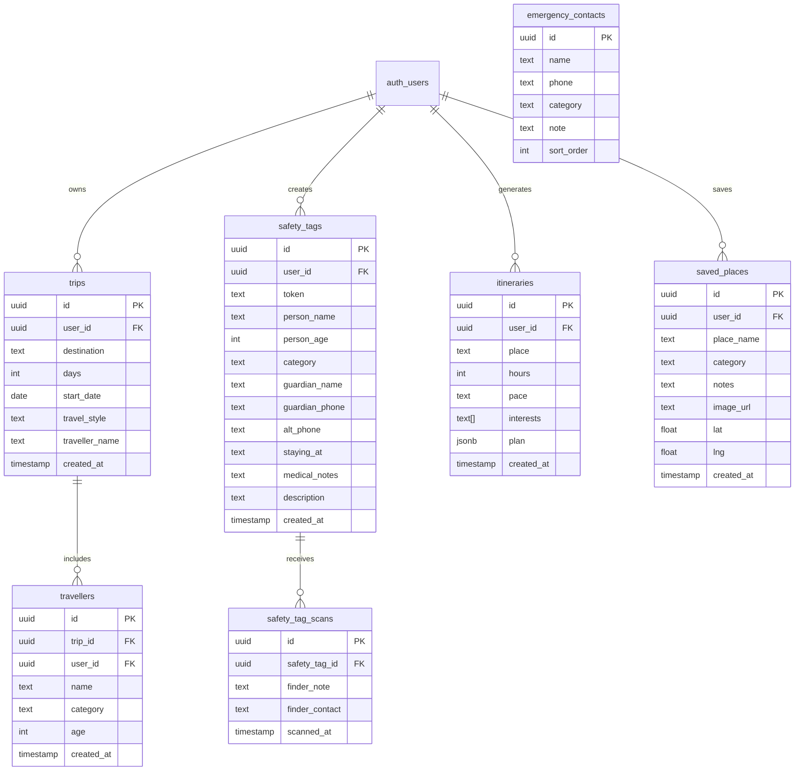

# Safr (Goa Guide Buddy) — Comprehensive Project & Technical Documentation

---

## 📌 Table of Contents
1. [Project Overview & Vision](#1-project-overview--vision)
2. [Complete Tech Stack Breakdown](#2-complete-tech-stack-breakdown)
3. [Database Architecture, Schema & RLS Policies](#3-database-architecture-schema--rls-policies)
4. [External APIs, Third-Party Services & Integrations](#4-external-apis-third-party-services--integrations)
5. [Algorithms, Mathematical Heuristics & Core Logic](#5-algorithms-mathematical-heuristics--core-logic)
6. [Core Features & Application Modules](#6-core-features--application-modules)
7. [UI/UX Design System, Typography & Animations](#7-uiux-design-system-typography--animations)
8. [Complete Dependency Breakdown (`package.json`)](#8-complete-dependency-breakdown-packagejson)
9. [Project Directory & File Structure](#9-project-directory--file-structure)
10. [Local Development, Environment Setup & Deployment](#10-local-development-environment-setup--deployment)

---

## 1. Project Overview & Vision

**Safr** (piloted in Goa, engineered for India) is a full-stack, AI-powered travel safety companion web application. It bridges the gap between traditional tourism guides and mission-critical traveler security by integrating real-time geospatial routing intelligence, crowd density estimation, safe-vs-fast route comparisons with step-by-step turn directions, smart transport mode advice, 7-day marine and weather forecasts, automated AI itinerary planning with strict time budgeting, family QR safety wristbands with privacy-first notifications, live GPS radar tracking, verified emergency directory access, and multi-lingual Indian language accessibility including Konkani.

- **Application Name**: Safr (Goa Guide Buddy)
- **Author / Development Team**: Team KoS
- **Core Tagline**: *"Travel safer. Skip the trouble."*
- **Primary Domain**: Smart Tourism / Travel Tech / AI Safety Companion / Geospatial Navigation
- **Target Audience**: Solo travelers, families with children or senior citizens, backpackers, and international tourists exploring Goa.
- **Current Status**: Active & Live; Supabase database initialized (`<your-project-id>`), Gemini AI connected, OSRM/Overpass/Photon routing integrated, 14/14 automated test suites passing.

---

## 2. Complete Tech Stack Breakdown

### Frontend Tier
- **Framework**: [React 19.2](https://react.dev/) + [TypeScript (ES2022 / Strict)](https://www.typescriptlang.org/)
- **Routing & Full-Stack SSR**: [TanStack Router](https://tanstack.com/router) + [TanStack Start](https://tanstack.com/start) with file-based routing and server functions (`createServerFn`).
- **Data Fetching & State Management**: [TanStack Query v5](https://tanstack.com/query) (`@tanstack/react-query`) with automatic background caching, invalidation, and optimistic updates.
- **Styling & Design System**: [TailwindCSS v4](https://tailwindcss.com/) with OKLCH color spaces, custom glassmorphism utilities, and CSS `@keyframes` animations.
- **Interactive Mapping**: [Leaflet 1.9.4](https://leafletjs.com/) with OpenStreetMap vector tiles, custom div markers, 1.5 km corridor polygons, and polyline route layers.
- **Icons & Visuals**: [Lucide React](https://lucide.dev/) + [QRCode Canvas Generator](https://www.npmjs.com/package/qrcode).
- **Notifications & Feedback**: [Sonner Toast Notifications](https://sonner.emilkowal.ski/) with explicit login/signup confirmations.
- **Multi-Language Accessibility**: Google Translate integration supporting Konkani (`gom` / कोंकणी), Hindi, Marathi, Bengali, Tamil, Telugu, Kannada, Gujarati, Spanish, Russian, French, and German.

### Backend Tier & Server Functions
- **Server Execution**: TanStack Start Server Functions running in Node.js (Node >= 24.0.0) with strict TypeScript schema validation (`zod`).
- **Geospatial & Navigation Engine**: Open Source Routing Machine ([OSRM](http://project-osrm.org/)) API for route distance calculations, driving duration matrices, and turn maneuver step extraction.
- **Geocoding & Place Search**: [Photon Komoot API](https://photon.komoot.io/) with Indian state bounding to prevent false location defaults, plus [Overpass API](https://overpass-api.de/api/interpreter) for 1.5 km route corridor point-of-interest discovery.
- **AI Intelligence**: Google Gemini 2.5 Flash via `@ai-sdk/google` (`ai` v7 / Vercel AI SDK) with structured JSON output and schema validation, grounded strictly on real OpenStreetMap place IDs with an automated map-based fallback.

### Database & Security Tier
- **Database Engine**: [Supabase PostgreSQL](https://supabase.com/) (Active Project: `<your-project-id>`) with Row Level Security (RLS) on every table.
- **Authentication**: Supabase Auth (Email + Password, Magic Link, Session JWTs, and client-side token persistence).
- **Stored Procedures (RPC)**: PL/pgSQL stored procedures (`check_safety_tag`, `notify_safety_tag`) for Zero-Knowledge SafeTag verification and alert dispatch.
- **Data Integrity Constraints**: `CHECK` constraints enforcing valid age bounds (kid 0–17, adult 18–59, senior 60–120) across `safety_tags` and `travellers`.

---

## 3. Database Architecture, Schema & RLS Policies



### Table Definitions & Purpose

1. **`trips`**: Stores active and past trips created by users, including destination, duration, start dates, and lead traveler name.
2. **`travellers`**: Represents individual party members (adults, kids, seniors) attached to a trip, verified with category age constraints.
3. **`safety_tags`**: Stores Zero-Knowledge family safety tags, unique cryptographic hex tokens, guardian contacts, hotel locations, and medical notes. Enforces age-category bounds.
4. **`safety_tag_scans`**: Logs scan/alert events submitted by Good Samaritans / finders when a lost person is located.
5. **`saved_places`**: User wishlist and saved bucket list items with coordinates, categories, custom notes, and image thumbnails.
6. **`itineraries`**: Persists AI-generated schedules, hour-by-hour plans, travel times, and pace configurations.
7. **`emergency_contacts`**: Curated directory of 11 verified Goan emergency hotlines (112 Police, 108 Ambulance, Drishti Marine Lifeguards, Tourist Police, Pink Force, GMC Hospital Bambolim, Women Helpline 1091, Child Helpline 1098).
8. **`profiles`**: User metadata and display name automatically populated via `handle_new_user` trigger on `auth.users`.

### Zero-Knowledge Stored Procedures & Age Constraints

```sql
-- SafeTag lookup: verifies active status without exposing guardian contact or hotel
CREATE OR REPLACE FUNCTION public.check_safety_tag(_token TEXT)
RETURNS TABLE (tag_id UUID, category TEXT, is_active BOOLEAN) LANGUAGE sql STABLE SECURITY DEFINER SET search_path = public AS $$
  SELECT t.id, t.category, true
  FROM public.safety_tags t
  WHERE t.token = _token;
$$;

-- Finder alert dispatch: records note and contact without leaking guardian data
CREATE OR REPLACE FUNCTION public.notify_safety_tag(_token TEXT, _finder_note TEXT DEFAULT NULL, _finder_contact TEXT DEFAULT NULL)
RETURNS BOOLEAN LANGUAGE plpgsql STABLE SECURITY DEFINER SET search_path = public AS $$
DECLARE
  _tag_id UUID;
BEGIN
  SELECT id INTO _tag_id FROM public.safety_tags WHERE token = _token;
  IF _tag_id IS NULL THEN RETURN false; END IF;
  INSERT INTO public.safety_tag_scans (safety_tag_id, finder_note, finder_contact)
  VALUES (_tag_id, _finder_note, _finder_contact);
  RETURN true;
END;
$$;

-- Age category constraints: strictly enforces valid ages
ALTER TABLE public.safety_tags ADD CONSTRAINT safety_tags_age_category_check CHECK (
  person_age IS NOT NULL AND person_age BETWEEN 0 AND 120 AND (
    (category = 'kid' AND person_age < 18) OR
    (category IN ('adult', 'member') AND person_age >= 18 AND person_age < 60) OR
    (category = 'senior' AND person_age >= 60)
  )
) NOT VALID;
```

---

## 4. External APIs, Third-Party Services & Integrations

| Service / API | Endpoint / Library | Key Required? | Purpose in Safr |
|---|---|---|---|
| **Supabase Database & Auth** | `<your-supabase-url>` | Publishable Key (`sb_publishable_...`) | User authentication, RLS tables, session management, SafeTag RPCs. |
| **Google Gemini AI** | `@ai-sdk/google` (`gemini-2.5-flash`) | Yes (`GEMINI_API_KEY`, server-only) | Structured itinerary ranking and contextual Goan insights. Automatic map fallback on throttling. |
| **Open Source Routing Machine (OSRM)** | `https://router.project-osrm.org` | No (Public) | Multi-alternative routing, driving-time duration matrix, and maneuver step extraction. |
| **Photon Geocoding** | `https://photon.komoot.io/api/` | No (Public) | Forward search of Goan towns, beaches, and landmarks with state-level boundary checks. |
| **Overpass API (OSM)** | `https://overpass-api.de/api/interpreter` | No (Public) | 1.5 km corridor point-of-interest discovery (restaurants, hotels, sights) along driving routes. |
| **Open-Meteo Weather** | `https://api.open-meteo.com/v1/forecast` | No (Public) | Current temperature, precipitation probability, wind speed, and Panjim marine conditions. |
| **Google Maps Navigation** | `https://www.google.com/maps/dir/?api=1` | No (Deep link) | 1-Tap launch of native GPS turn-by-turn navigation on iOS and Android. |

---

## 5. Algorithms, Mathematical Heuristics & Core Logic

### 1. Multi-Factor Route Safety Scoring Algorithm
When comparing driving paths between two coordinates, Safr calculates a composite safety score $S \in [0, 100]$:

$$S = 100 - P_{\text{distance}} - P_{\text{speed}} - P_{\text{night}} - P_{\text{ghat}}$$

- **$P_{\text{distance}}$ (Distance Detour Penalty)**: Penalizes excessive detours beyond minimum distance $d_{\min}$.
- **$P_{\text{speed}}$ (Speed Hazard Penalty)**: Evaluates high average speeds indicating hazardous, winding highway sections:
  $$v_{\text{avg}} = \frac{d}{t} \times 60 \quad (\text{km/h})$$
- **$P_{\text{night}}$ (Night-Time Unlit Road Penalty)**: If the current time is between 19:00 and 06:00, routes bypassing well-lit coastal highways receive an additional 15-point penalty.
- **$P_{\text{ghat}}$ (Hairpin Curve Penalty)**: Extracted from OSRM sharp left/right maneuver frequencies.

### 2. Time-Budgeted Dynamic Itinerary Optimization
Given total free hours $H \in [1, 24]$, start time $T_0$, and pace $P \in \{\text{Relaxed}, \text{Balanced}, \text{Packed}\}$:
1. **Driving Time Matrix**: Queries OSRM road distance matrix for accurate travel times between candidate stops rather than straight-line approximations.
2. **Buffer & Return Allowance**: Automatically allocates arrival buffers, realistic visit durations, and optional return drive times within budget.
3. **Grounded AI Selection**: Gemini ranks only real OpenStreetMap candidate IDs; it cannot hallucinate coordinates or times.
4. **Graceful Fallback**: If AI ranking fails or is rate-limited, an algorithmic map-based fallback generates a valid schedule with an explicit UI notice.

### 3. Marine Beach Swimming Flag Decision Matrix
Evaluates Open-Meteo wind vectors and weather codes to estimate swimming conditions:

| Flag Status | Wind Speed ($v$) | Weather Condition | Safety Recommendation |
|---|---|---|---|
| 🟢 **Green (Safe)** | $v < 20 \text{ km/h}$ | Clear / Partly cloudy | Safe for recreational swimming within patrol zones. |
| 🟡 **Yellow (Caution)** | $20 \le v \le 35 \text{ km/h}$ | Moderate swell, light drizzle | Swim only in designated zones; keep children near shore. |
| 🔴 **Red (Danger)** | $v > 35 \text{ km/h}$ or Code $\ge 80$ | High tide swell, thunderstorms | **Strictly no swimming.** Dangerous rip currents in effect. |

---

## 6. Core Features & Application Modules

### 1. 🌟 High-Impact Landing Page (`/`)
- Dynamic animated safety proposition pills and 3-way action entry points.
- Direct entry into **Start Planning**, **Sign In**, and **"Found someone? Enter OTP"**.
- Public emergency trust metrics and quick helpline access.

### 2. 🧭 Floating Global App Shell (`app-shell.tsx`)
- Floating top glass header with dynamic back navigation, live weather indicator, Konkani/Indian language selector, emergency dialer, and user avatar.
- Mobile-first bottom navigation dock with glowing active route indicators for **Dashboard**, **Map**, **Explore**, **Itinerary**, and **SafeTags**.

### 3. 📊 Trip Command Center Bento Dashboard (`/dashboard`)
- Separated Trip Overview card displaying travel style (`SOLO VOYAGER`, `3 Days Plan`), lead traveler details, party member counts, and destination.
- Standalone Weather Station card with live temperature, weather conditions, wind speeds, and marine swimming flag indicators.
- Quick navigation tiles to Map, Explore, Itinerary, SafeTags, Live Radar, and Emergency Hub.

### 4. 🗺️ Full-Height Safe Route Workspace (`/map`)
- Night-travel safety advisory badge with real-time Goa lighting alerts.
- 3-Route comparison cards (**Safer Route**, **Fastest Route**, **Scenic Alternative**) with safety score ratings out of 100.
- 1.5 km corridor search displaying nearby restaurants, hotels, and sights along the chosen route.
- Turn-by-turn directions drawer with maneuver icons and 1-tap Google Maps GPS launch.

### 5. 🌴 Place Explorer & Bucket List (`/explore`)
- Vibe filter chips (*Beaches*, *Monuments*, *Nightlife*, *Cafes*, *Nature*).
- Real-time crowd gauge with density bands (*quiet*, *moderate*, *busy*, *packed*) and best visiting hours.
- Best Mode of Transport card (Scooters, Cars, Jeeps, Ferries, Walking) with parking advice.
- 1-Tap Heart Bookmarking to **Saved Bucket List (❤️)** with Supabase persistence.

### 6. ✨ AI Itinerary Planner (`/itinerary`)
- Time-budget controls for free hours (1–24h), departure time, and pace (Relaxed, Balanced, Packed).
- Sequential visual timeline with stop numbers, duration badges, and direct "Navigate" buttons.
- Print & PDF export layout for offline reference.

### 7. 🏷️ Family SafeTag Wristband Studio (`/safety-tags`)
- Printable water-resistant QR wristbands and unique cryptographic tokens for children and senior citizens.
- Strict age category validation preventing invalid or mismatched ages.
- Real-time guardian alert log when a tag is scanned or looked up by a finder.

### 8. 🚨 Public Verified Emergency Directory (`/emergency`)
- Accessible without signing in.
- Verified official contacts: Pink Force, Goa Police (100/112), Ambulance (108), Fire (101), Drishti Marine Lifeguards (+91 832 252 0717), Goa Tourist Police (+91 832 242 8383), GMC Hospital Bambolim (+91 832 249 5000), Women Helpline (1091), Child Helpline (1098).

---

## 7. UI/UX Design System, Typography & Animations

### OKLCH Color Tokens
- **Warm Pearl (Light Mode)**: `--background: oklch(0.978 0.012 85)`, `--card: oklch(0.995 0.005 85 / 0.88)`
- **Deep Obsidian (Dark Mode)**: `--background: oklch(0.12 0.022 245)`, `--card: oklch(0.165 0.026 245 / 0.75)`
- **Electric Cyan**: `oklch(0.78 0.16 200)` (`#00F2FE`)
- **Sunset Coral**: `oklch(0.68 0.20 38)` (`#FF6B4A`)
- **Neon Emerald**: `oklch(0.75 0.17 155)` (`#10B981`)

### Typography Hierarchy
- **Display Headings**: `Fraunces`, `Syne`, serif/display
- **Body & Controls**: `Plus Jakarta Sans`, `DM Sans`, sans-serif
- **Monospace & Tokens**: `JetBrains Mono`, monospace

---

## 8. Complete Dependency Breakdown (`package.json`)

```json
{
  "name": "safr",
  "private": true,
  "type": "module",
  "scripts": {
    "dev": "vite dev",
    "dev:open": "vite dev --open",
    "build": "vite build",
    "preview": "vite preview",
    "lint": "eslint .",
    "format": "prettier --write .",
    "test": "node --import ./scripts/register-typescript.mjs --test tests/*.test.ts",
    "typecheck": "tsc --noEmit",
    "check:services": "node scripts/check-services.mjs",
    "check:itinerary": "node --import ./scripts/register-typescript.mjs scripts/check-itinerary.mjs"
  },
  "dependencies": {
    "@ai-sdk/google": "^4.0.44",
    "@supabase/supabase-js": "^2.112.2",
    "@tanstack/react-query": "^5.101.1",
    "@tanstack/react-router": "1.170.18",
    "@tanstack/react-start": "1.168.32",
    "ai": "^7.0.58",
    "clsx": "^2.1.1",
    "leaflet": "^1.9.4",
    "lucide-react": "^0.575.0",
    "qrcode": "^1.5.4",
    "react": "^19.2.0",
    "react-dom": "^19.2.0",
    "sonner": "^2.0.7",
    "tailwind-merge": "^3.5.0",
    "tailwindcss": "^4.2.1",
    "zod": "^3.24.2"
  },
  "devDependencies": {
    "@types/leaflet": "^1.9.22",
    "@types/node": "^22.16.5",
    "@types/qrcode": "^1.5.6",
    "@types/react": "^19.2.0",
    "@types/react-dom": "^19.2.0",
    "typescript": "^5.8.3",
    "vite": "^8.2.0"
  },
  "engines": {
    "node": ">=24.0.0"
  }
}
```

---

## 9. Project Directory & File Structure

```
goa-guide-buddy-main/
├── public/                     # Static assets and icons
├── scripts/
│   ├── check-services.mjs      # Real-time connectivity tester (Photon, OSRM, Supabase, Gemini)
│   ├── check-itinerary.mjs     # Live itinerary generation verification
│   └── register-typescript.mjs # TypeScript loader for test execution
├── src/
│   ├── components/
│   │   ├── ui/                 # Reusable UI primitives (Button, Input, Label, Textarea)
│   │   ├── app-shell.tsx       # Floating header & mobile dock
│   │   ├── GoogleTranslate.tsx # Indian language translation selector with Konkani
│   │   └── NearbyPlaces.tsx    # Corridor search POI drawer
│   ├── integrations/
│   │   └── supabase/
│   │       ├── client.ts       # Supabase client with publishable key fetch wrapper
│   │       └── types.ts        # Database TypeScript schema definitions
│   ├── lib/
│   │   ├── goa-schemas.ts      # Zod validation schemas
│   │   ├── goa.functions.ts    # Server functions for insights & transport
│   │   ├── maps.server.ts      # OSRM routing engine & safety scorer
│   │   └── travel.server.ts    # Budget-enforcing itinerary scheduler & AI ranking
│   ├── routes/
│   │   ├── _authenticated/     # Protected routes
│   │   │   ├── dashboard.tsx   # Trip overview & weather Bento
│   │   │   ├── explore.tsx     # Place explorer & bucket list
│   │   │   ├── itinerary.tsx   # AI Itinerary builder
│   │   │   ├── map.tsx         # Route comparison & corridor map
│   │   │   ├── safety-tags.tsx # SafeTag wristband studio
│   │   │   └── setup.tsx       # Initial trip wizard
│   │   ├── __root.tsx          # Root layout & providers
│   │   ├── auth.tsx            # Login & registration with toast feedback
│   │   ├── emergency.tsx       # Public emergency directory
│   │   ├── find.tsx            # Public SafeTag OTP lookup
│   │   ├── index.tsx           # Landing page
│   │   └── t.$token.tsx        # Public QR scan finder flow
│   ├── main.tsx                # Client entry point
│   ├── router.tsx              # TanStack router setup
│   └── styles.css              # Design tokens & CSS variables
├── supabase/
│   ├── migrations/             # Incremental migration files
│   └── schema.sql              # Consolidated one-click database schema
├── tests/
│   ├── services.test.ts        # Service connectivity & fallback tests
│   └── travel.test.ts          # Budget, time continuity, and boundary tests
├── API_SETUP.md                # API setup instructions & key reference
├── IMPLEMENTATION_NOTES.md     # Change history & verification logs
├── information.md              # Technical documentation (This file)
├── MASTER_PROJECT_DOCUMENTATION.md # Exhaustive master documentation
├── package.json                # Project dependencies & scripts
├── run.bat                     # Quick-launch development script
└── tsconfig.json               # Strict TypeScript configuration
```

---

## 10. Local Development, Environment Setup & Deployment

### Prerequisites
- **Node.js**: Version 24.0.0 or higher
- **npm**: Version 10.0.0 or higher

### Environment Variables (`.env`)
Configured in `goa-guide-buddy-main/.env` (untracked, preserved locally):
```env
SUPABASE_PROJECT_ID="<your-project-id>"
SUPABASE_PUBLISHABLE_KEY="<your-publishable-key>"
SUPABASE_URL="<your-supabase-url>"
VITE_SUPABASE_PROJECT_ID="<your-project-id>"
VITE_SUPABASE_PUBLISHABLE_KEY="<your-publishable-key>"
VITE_SUPABASE_URL="<your-supabase-url>"
GEMINI_API_KEY="your-gemini-api-key"
```

### Installation & Execution
```bash
# 1. Install dependencies
npm install

# 2. Verify all external service connections
npm run check:services

# 3. Run automated unit tests (14 tests)
npm test

# 4. Run TypeScript typecheck
npm run typecheck

# 5. Start local development server
npm run dev

# 6. Build production bundle
npm run build
```

---
*Documentation updated and verified for Safr (Goa Guide Buddy) on 19 September 2026 by Team KoS.*
